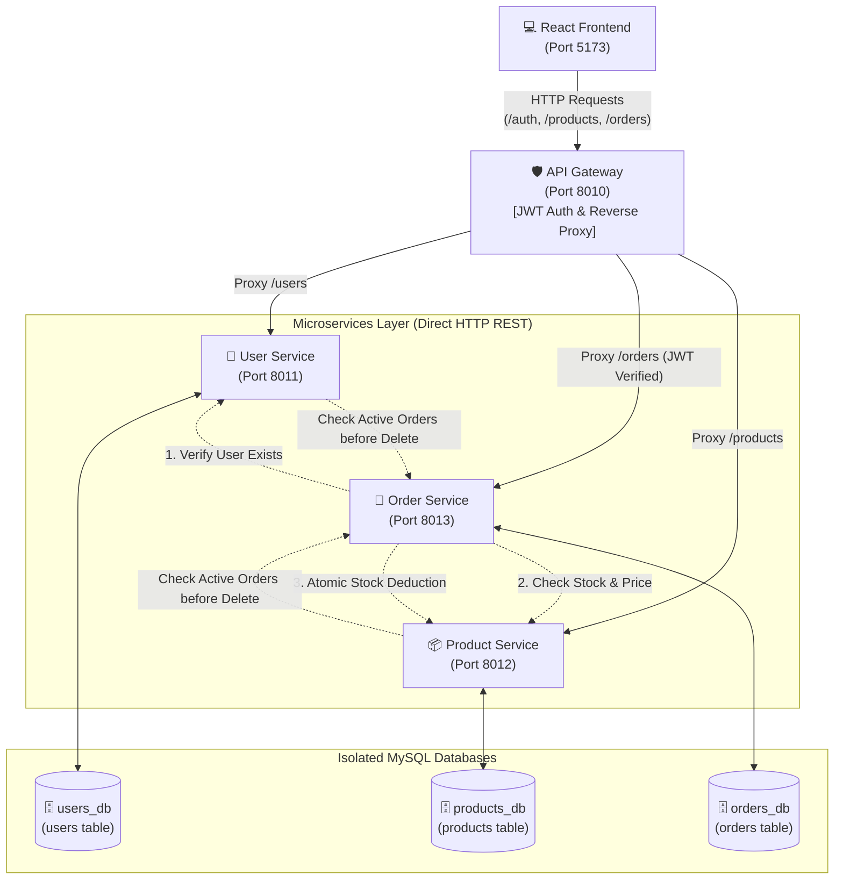
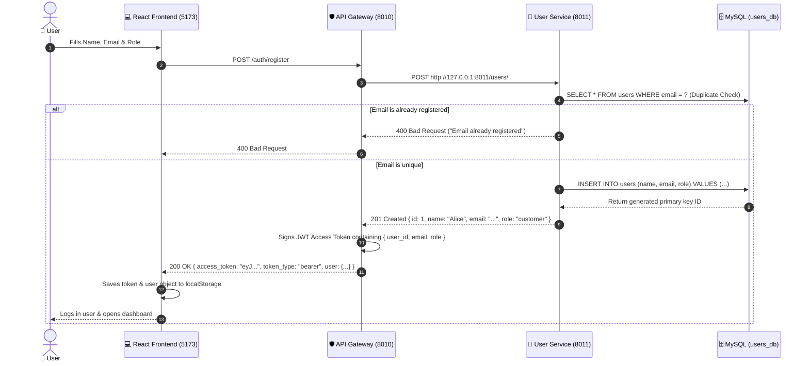
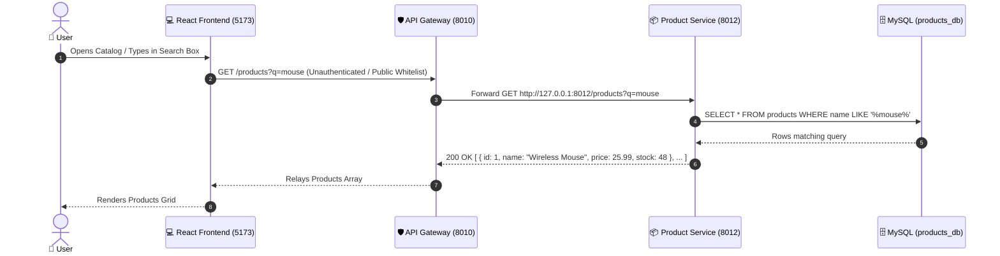
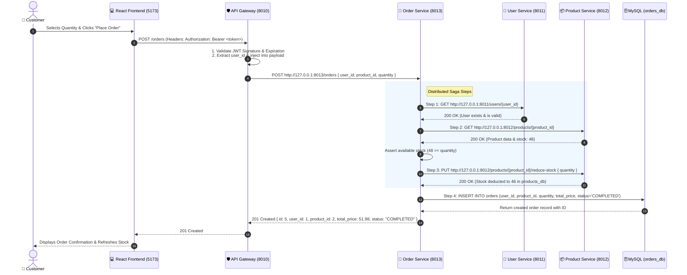
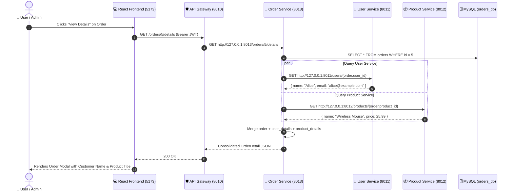
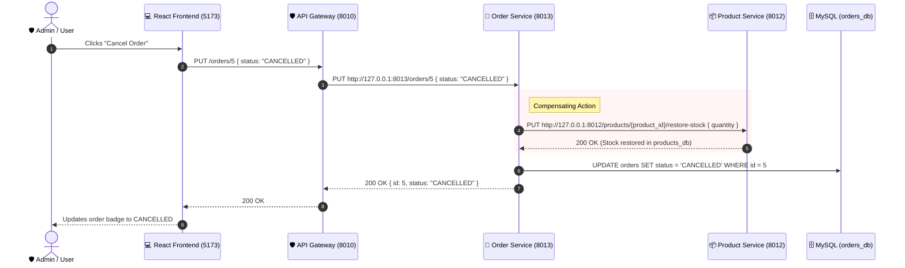
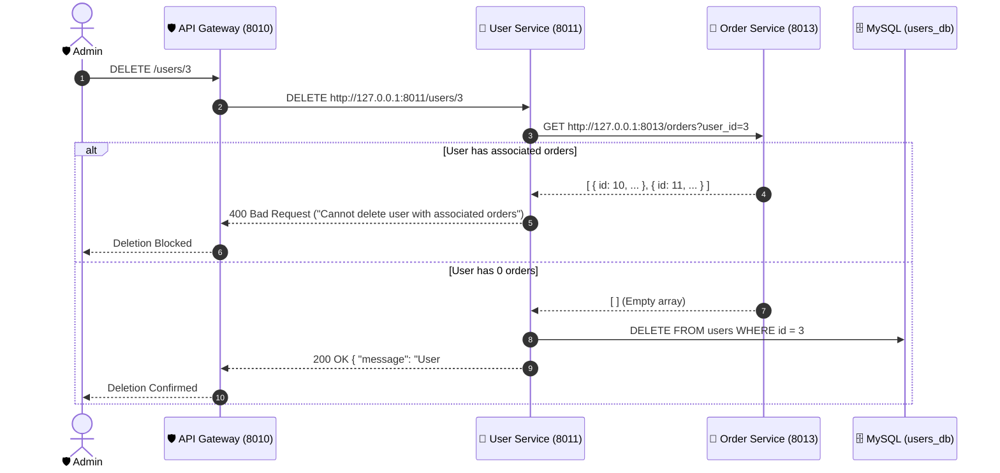

# 🏛️ System Architecture & Data Travel Documentation

This document provides a complete visual and technical breakdown of the distributed microservices platform, its communication channels, and exact data travel flows.

---

## 1. High-Level Architecture Diagram



---

## 2. Service Directory & Network Ports

| Component | Port | Base URL | Swagger Docs | Database Schema | Primary Role |
| :--- | :--- | :--- | :--- | :--- | :--- |
| **API Gateway** | `8010` | `http://127.0.0.1:8010` | `/docs` | Stateless / JWT | Single Entry Point, JWT Gatekeeper, RBAC, Reverse Proxy |
| **User Service** | `8011` | `http://127.0.0.1:8011` | `/docs` | MySQL: `users_db` | User Identity, Profiles, Role Management |
| **Product Service** | `8012` | `http://127.0.0.1:8012` | `/docs` | MySQL: `products_db` | Product Catalog, Pricing, Inventory Stock Tracking |
| **Order Service** | `8013` | `http://127.0.0.1:8013` | `/docs` | MySQL: `orders_db` | Saga Orchestration, Order Lifecycle, Data Federation |
| **React Frontend** | `5173` | `http://localhost:5173` | N/A (Web UI) | LocalStorage | Responsive User Dashboard, Catalog, Order UI |

---

## 3. Detailed Data Travel Flows

### Flow A: User Registration & Login (Authentication)



---

### Flow B: Public Product Catalog Browsing



---

### Flow C: Order Placement (Distributed Saga Transaction)

When an order is created, `order_service` acts as the orchestrator to verify the customer, check inventory, atomically deduct stock, and store the order.



---

### Flow D: Federated Order Details (Data Aggregation)



---

### Flow E: Order Cancellation & Compensating Stock Restoration



---

### Flow F: Distributed Referential Integrity (Safe Deletion)



---

## 4. Code File Architecture Map

```
microservices/
├── .env                         # Central DB passwords, JWT secrets, and port configs
├── README.md                    # Project overview and quick start manual
├── ARCHITECTURE.md              # THIS DOCUMENT (Visual flow and technical reference)
├── run_all.py                   # Master process runner for all 5 components
├── test_crud.py                 # Automated 17/17 RBAC & CRUD integration test suite
├── verify.py                    # Gateway & distributed flow verification script
│
├── gateway_service/             # API GATEWAY (Port 8010)
│   ├── auth.py                  # JWT encoding, decoding, expiration validation
│   └── main.py                  # Catch-all reverse proxy, ACL whitelist, RBAC logic
│
├── user_service/                # USER MICROSERVICE (Port 8011)
│   ├── database.py              # PyMySQL engine (users_db) with connection pooling
│   ├── models.py                # SQLAlchemy ORM User entity
│   ├── schemas.py               # Pydantic schemas (UserCreate, UserUpdate, User)
│   └── main.py                  # FastAPI route controllers & DB CRUD operations
│
├── product_service/             # PRODUCT MICROSERVICE (Port 8012)
│   ├── database.py              # PyMySQL engine (products_db) with connection pooling
│   ├── models.py                # SQLAlchemy ORM Product entity
│   ├── schemas.py               # Pydantic schemas (ProductCreate, ProductUpdate, etc.)
│   └── main.py                  # Catalog endpoints, search/filter, atomic stock reduction
│
├── order_service/               # ORDER MICROSERVICE (Port 8013)
│   ├── database.py              # PyMySQL engine (orders_db) with connection pooling
│   ├── models.py                # SQLAlchemy ORM Order entity
│   ├── schemas.py               # Pydantic schemas (OrderCreate, OrderDetail, etc.)
│   └── main.py                  # Saga coordinator, inter-service HTTPX calls, federation
│
└── frontend/                    # REACT 18 + VITE (Port 5173)
    ├── package.json             # NPM dependencies
    ├── vite.config.js           # Vite dev server configuration
    └── src/
        ├── App.jsx              # Unified user dashboard, catalog, auth, order manager
        └── index.css            # Responsive layout styling
```

