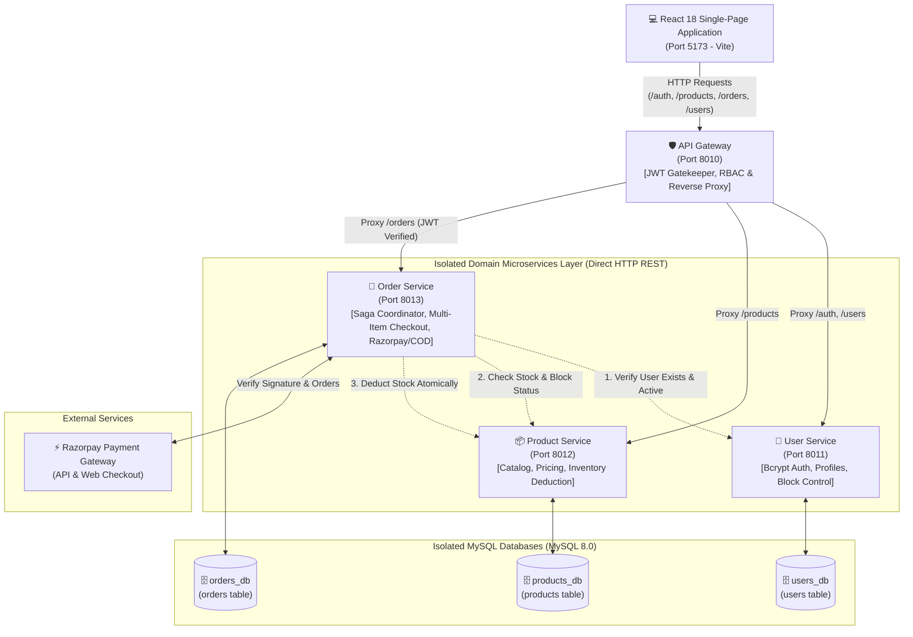
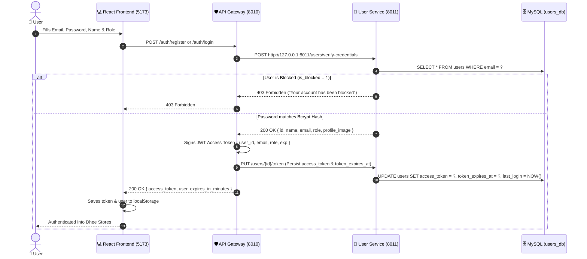
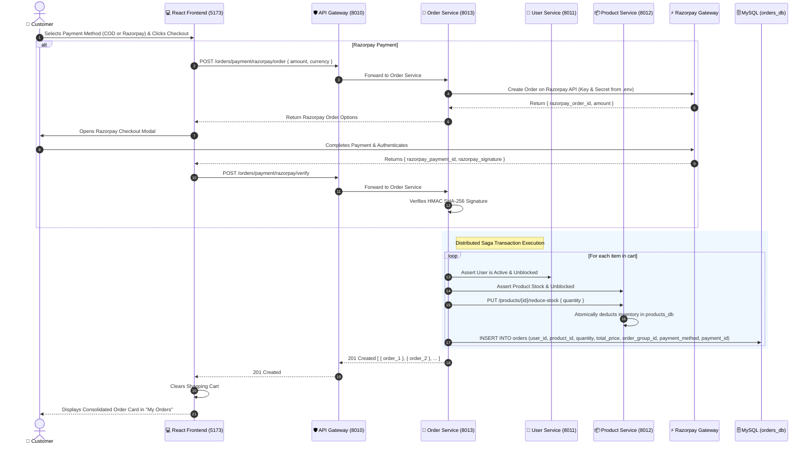
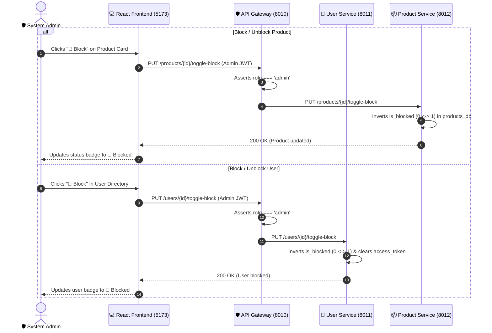

# 🏛️ System Architecture & Data Travel Documentation

This document provides a comprehensive visual and technical architectural breakdown of the **Dhee Stores** distributed microservices platform, its isolated database schemas, inter-service communication channels, security mechanisms, and complete end-to-end data travel flows.

---

## 1. High-Level Architecture Diagram



---

## 2. Service Directory & Network Ports

| Component | Port | Base URL | Swagger Docs | Database Schema | Primary Role |
| :--- | :--- | :--- | :--- | :--- | :--- |
| **API Gateway** | `8010` | `http://127.0.0.1:8010` | `/docs` | Stateless / JWT | Single Entry Point, JWT Verification, RBAC Enforcement, Reverse Proxy |
| **User Service** | `8011` | `http://127.0.0.1:8011` | `/docs` | MySQL: `users_db` | User Identity, Bcrypt Hashing, Soft Block, Profile Management |
| **Product Service** | `8012` | `http://127.0.0.1:8012` | `/docs` | MySQL: `products_db` | Product Catalog, Pricing, Inventory Stock Tracking, Product Block |
| **Order Service** | `8013` | `http://127.0.0.1:8013` | `/docs` | MySQL: `orders_db` | Saga Orchestrator, Multi-Item Cart Checkout, COD & Razorpay Verification |
| **React Frontend** | `5173` | `http://localhost:5173` | N/A (Web UI) | LocalStorage | Responsive E-Commerce Dashboard, Steppers, Analytics & Cart |

---

## 3. Database Schemas & Table Architecture

Each microservice manages its own completely isolated MySQL schema. Foreign keys across microservices are maintained logically through distributed saga orchestration rather than direct database-level joins.

### 3.1 `users_db.users`
Stores user credentials, access tokens, and administrative block flags:
```sql
CREATE TABLE users (
    id INT AUTO_INCREMENT PRIMARY KEY,
    name VARCHAR(255) NOT NULL,
    email VARCHAR(255) NOT NULL UNIQUE,
    role VARCHAR(50) NOT NULL DEFAULT 'customer',
    password VARCHAR(255) NULL,              -- Bcrypt hashed password ($2b$12$...)
    is_blocked TINYINT(1) NOT NULL DEFAULT 0, -- 0 = Active, 1 = Blocked
    profile_image TEXT NULL,                 -- Custom profile avatar URL
    access_token TEXT NULL,                  -- Active persisted JWT token
    token_expires_at DATETIME NULL,          -- Token expiration timestamp
    last_login DATETIME NULL                 -- Timestamp of most recent login
) ENGINE=InnoDB DEFAULT CHARSET=utf8mb4;
```

### 3.2 `products_db.products`
Maintains the merchandise catalog and real-time inventory levels:
```sql
CREATE TABLE products (
    id INT AUTO_INCREMENT PRIMARY KEY,
    name VARCHAR(255) NOT NULL,
    price DECIMAL(10, 2) NOT NULL,
    stock INT NOT NULL DEFAULT 0,
    image_url TEXT NULL,                     -- High-resolution product image URL
    is_blocked TINYINT(1) NOT NULL DEFAULT 0 -- 0 = Active, 1 = Blocked
) ENGINE=InnoDB DEFAULT CHARSET=utf8mb4;
```

### 3.3 `orders_db.orders`
Records purchase transactions with support for multi-item sessions and payment tracking:
```sql
CREATE TABLE orders (
    id INT AUTO_INCREMENT PRIMARY KEY,
    user_id INT NOT NULL,
    product_id INT NOT NULL,
    quantity INT NOT NULL DEFAULT 1,
    total_price DECIMAL(10, 2) NOT NULL,
    status VARCHAR(50) NOT NULL DEFAULT 'COMPLETED', -- COMPLETED, CANCELLED
    order_group_id VARCHAR(100) NULL,                -- Unified Cart Checkout Session ID
    payment_method VARCHAR(50) NOT NULL DEFAULT 'COD',-- COD, RAZORPAY
    payment_id VARCHAR(100) NULL                     -- Razorpay Payment ID or Transaction Ref
) ENGINE=InnoDB DEFAULT CHARSET=utf8mb4;
```

---

## 4. End-to-End Data Travel Flows

### Flow A: User Registration & Dynamic Bcrypt Login
All credentials are dynamically stored and validated from MySQL. Passwords are never hardcoded.



---

### Flow B: Multi-Item Shopping Cart Checkout (COD & Razorpay)

When a customer checks out a cart containing multiple products, the system creates atomic order items linked by an `order_group_id`.



---

### Flow C: Administrative Soft Block / Unblock System

Instead of destructive deletions, administrators can toggle the block status of users and products:



---

### Flow D: Admin Business Analytics & Symmetrical Dashboard

The Admin Dashboard displays key performance metrics and symmetrical analytics cards:

1. **Top Metric Summary Cards**:
   - Total Platform Sales Revenue (`₹...`)
   - Total Orders Placed
   - Inventory Retail Valuation
   - Registered Customer & Admin Accounts
2. **Left Card: Symmetrical Donut Pie Chart**:
   - Interactive SVG donut visualization of sales share by product.
   - Live hover tooltips displaying product name, units sold, total revenue, and percentage share.
3. **Right Card: Catalog Stock & Cost Status Table**:
   - Tabular tabular-nums alignment.
   - Symmetrical 50/50 card width and matching height with sleek WebKit scrollbars.
   - Status badges (`🟢 Active` / `🚫 Blocked`) constrained to single-line horizontal pills.

---

## 5. Security & RBAC Enforcement Matrix

| Route Pattern | Method | Permitted Roles | Gateway Security Verification |
| :--- | :--- | :--- | :--- |
| `/auth/login`, `/auth/register` | `POST` | Public / All | Public whitelist; forwards credentials to User Service |
| `/products` | `GET` | Public / All | Public whitelist; browsable without authentication |
| `/products` | `POST` | `admin` only | Requires Bearer JWT with `role: "admin"` |
| `/products/{id}` | `PUT` | `admin` only | Requires Bearer JWT with `role: "admin"` |
| `/products/{id}/toggle-block` | `PUT` | `admin` only | Requires Bearer JWT with `role: "admin"` |
| `/users` | `GET` | `admin` only | Requires Bearer JWT with `role: "admin"` |
| `/users/{id}/toggle-block` | `PUT` | `admin` only | Requires Bearer JWT with `role: "admin"` |
| `/users/{id}` | `PUT` | Account Owner | Validates user ID against token payload |
| `/orders` | `POST` | Customer / Admin | Requires Bearer JWT; injects authenticated user ID |
| `/orders` | `GET` | Customer (Scoped) / Admin (Global) | Customers see only their orders; Admins see all platform orders |
